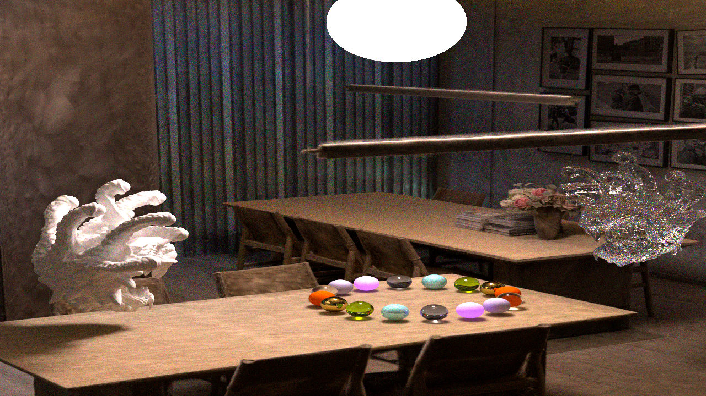
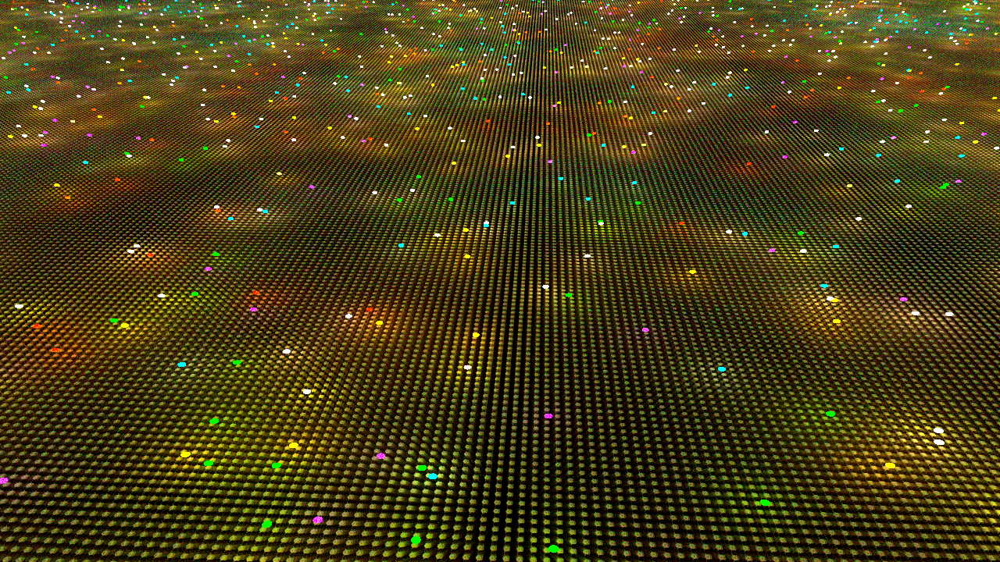
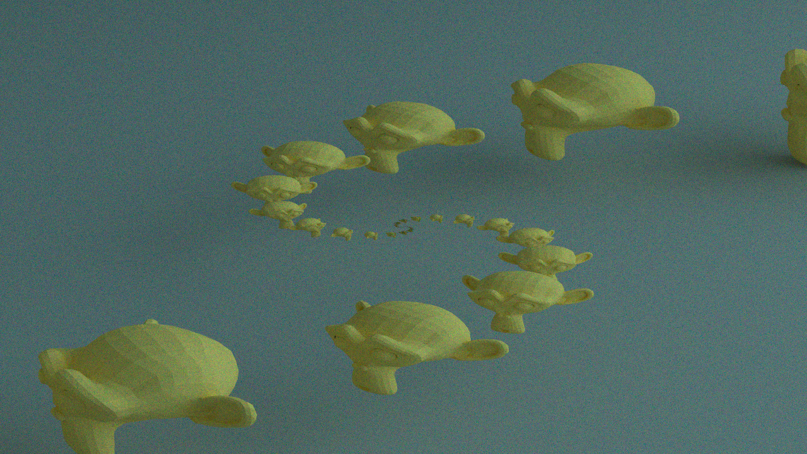
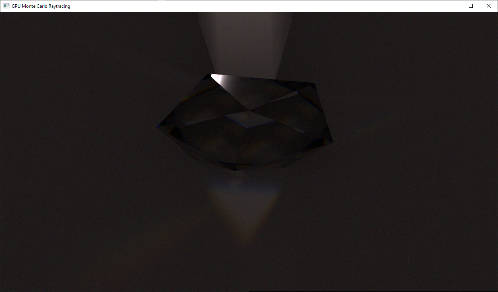
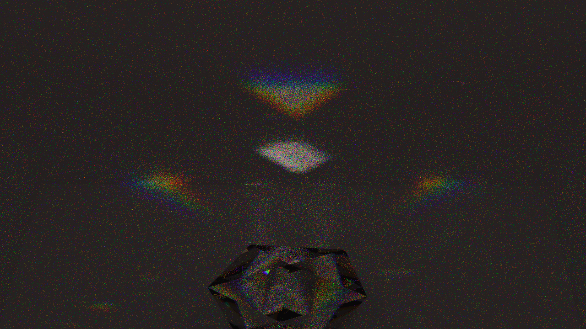
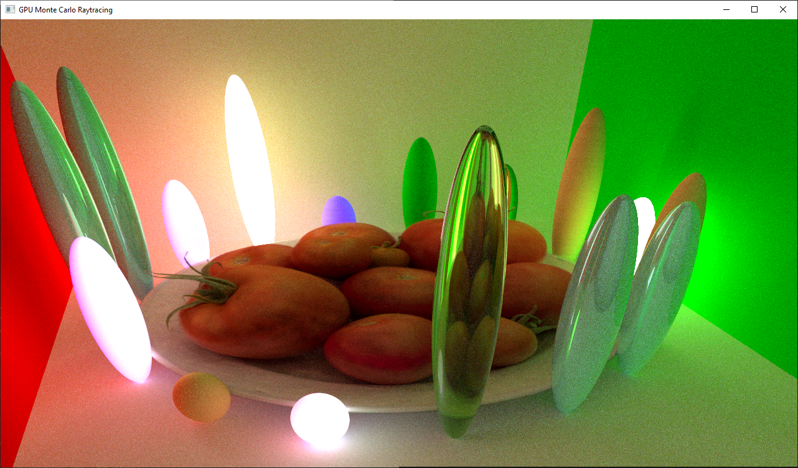
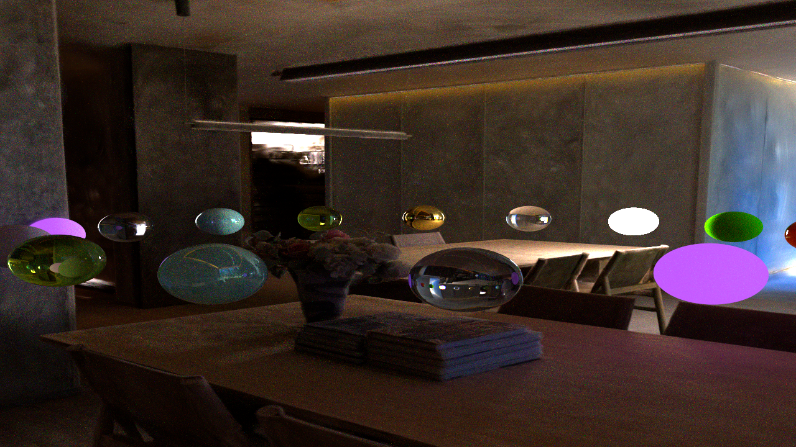
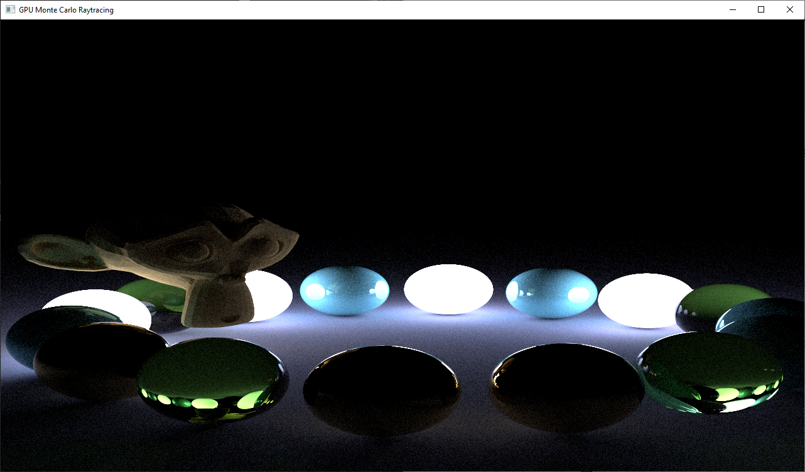
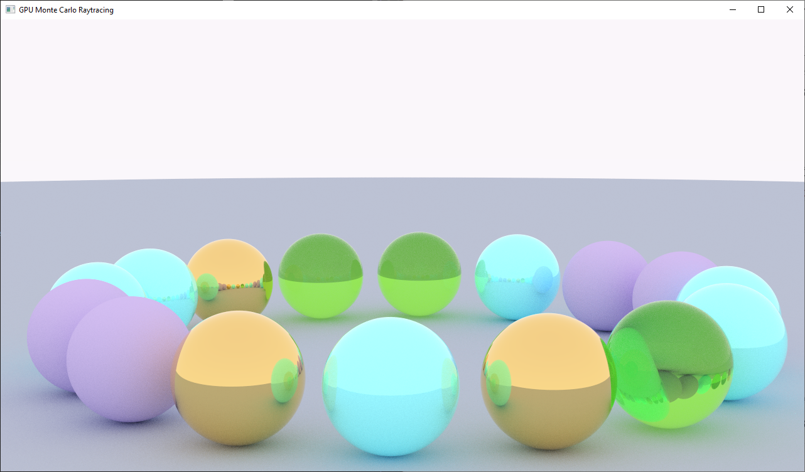

# Offline GPU Path Tracer



Interactive progressive spectral Monte Carlo GPU path tracer written in Slang and C++ using Vulkan.

> **What does "interactive offline" mean?** \
> This program runs in real-time, but images converges over time. \
> Therefore the viewer is "interactive" while the actual pathtracer is "offline" \
> More on this [below](#progressive).

This path tracer uses a compute-shader pipeline with custom BVH traversal algorithms. It does not use hardware RT.

# Controls

This path tracer is interactive. \
Mouse + WASD move the camera but the image only converges when the scene is the same as the previous frame. Each frame processes a single bounce, allowing for responsive temporal accumulation.

Camera movement uses FPS controls: mouse + `WASD` with `Q` and `E` for altitude control. \
Arrow keys `right` and `left` move through time. \
`R` locks the view and initiates the automated render sequence. \
`ESCAPE` ends the program.

# Project Features

- Sphere primitives
- Triangle primitives + OBJ loader
- BSDF material support for IOR and metallic
- Mesh lights
- Gaussian splat primitives + PLY loader
- Progressive path tracing with temporal accumulation and interactive camera
- Transforms (location, rotation, scale)
- Instancing
- TLAS/BLAS separation (stack TLAS, threaded BLAS)
- Mixed node types (transform, primitive, binary AABB, 8-wide AABB)
- Nested instances
- Spectral sampling
- Compute shader pipeline
- Animations with variable time step
- Threaded BVH traversal algorithm
- 8-wide KDOP BVH traversal algorithm
- 8-wide AABB BVH traversal algorithm
- Binary AABB BVH traversal algorithm
- CPU LBVH construction
- Stratified wavelengths

# Implementation Details and Performance Considerations

This section does not cover every aspect of the engine. (e.g., triangle and sphere intersections will not be covered)

> All performance metrics are from an RTX 4090 running at 1280x720. \
> Timing for each scene was recorded using NVIDIA Nsight Graphics. \
> Times presented are the average time per frame across the entire 10 bounce traversal sequence.

## Threaded Traversal

Early experiments with threaded bvh traversal yielded the following active frame times: \

| model         | threaded AABB  | binary AABB stack | 8-wide AABB stack |
| ------------- | -------------- | ----------------- | ----------------- |
| Beholder 3M   | 5.81 ms        | 7.24 ms           | 11.21 ms          |
| Beholder 1.7M | 2.35 ms        | 3.31 ms           | 4.93 ms           |

These results are for a single frame, which computes a single bounce for one ray per pixel. \
There is a lot more to do when optimizing the wide stack nodes. \
Specifically, the current algorithm introduces register pressure and does not use an optimal sort algorithm. The combination of these makes wide traversal suffer, especially in larger scenes.

## Transforms

Transforms are the easiest way to make instances of BLAS. Transforms have a single child that can be any node type (Inner node, Primitive, other transform, etc.).\
Since transforms point to an arbitrary child, this allows for the construction of nested instances..

## Nested Instances

The following will use these definitions: \
Primitive: a single triangle, sphere, Gaussian splat, etc. \
Instance: a collection of primitives contained in a BLAS. \
Collection: group of instances in an acceleration structure. 

Note: collections can contain other collections. This node structure means the following tree is possible:

```
root TLAS
├── transform
|       └── pointer to Collection 1
└── transform
        └── pointer to Collection 1

Collection 1 TLAS
        ├── pointer to Instance BLAS
        └── transform 
                └── pointer to Instance BLAS
```

Using this structure, an arbitrarily large number of primitives can be represented on a smaller footprint while also having a small build time.

For example: an N by N by N cube of Suzannes would contain N^3 Suzanne instances in a non-nested TLAS, but a nested TLAS can represent the same scene by repeating instances of collections of Suzannes. \
This lowers the memory footprint and build time for scenes with repeated groups of instances, \
allowing for much larger scenes in the same memory footprint and build-time constraints.

The following scene
8 billion instances of Suzanne illuminated by sphere mesh lights:


### Self-referencing Instances

Arbitrary nested instances also allow for procedurally generated and rendered recursive collections that are recursive collections that are expanded only as needed for what the camera sees. \
This means fractal structures, and other recursive trees, can be supported by storing a single branch.

This is only partially supported due to the limited Transform stack.

Below is initial testing using a collection containing Suzanne and a reference to the collection that has been rotated and scaled, creating a spiral pattern.


> This scene renders at 8.16 ms per frame

## Gaussian Splat Primitives

The PLY loader is adapted from [3D Gaussian Splatting in a Weekend](https://bfeldman.me/3dgs-weekend/).

Collisions with Gaussian splat primitives are calculated using their covariance matrix and center. \
The path tracer takes advantage of its Monte Carlo architecture to stochastically hit/miss splat primitives. \
By averaging samples across many rays, the path tracer simulates alpha blending of many splats.

Read more about this type of Gaussian splat ray tracing here: [Stochastic Ray Tracing of Transparent 3D Gaussians](https://arxiv.org/pdf/2504.06598)

## Time and Animations

Animations are supported by accessing `wrapper.time` during scene construction. \
Manual time steps are supported as well as automated rendering of animation sequences. Timesteps (`wrapper.time_delta`) can also be changed during an animation sequence, allowing for easy interpolation and modification of time in the animation. \
This results in effects such as:
- real-time to slow motion
- reversing time mid-animation
- fast-forward

## Automated Render Sequence

When initiated, the scene controls are locked and the renderer proceeds along the specified animation using: \
`wrapper.time` and `wrapper.time_delta` until a set number of frames have been rendered (`wrapper.numImagesPerSequence`). \
The number of rays accumulated per image is controlled by `wrapper.numFramesPerFile`. 

The scene is rebuilt between each subsequent time step in the animation.

## Stratified Wavelengths and Progressive Rendering {#progressive}

To reduce the number of frames needed to converge on a correct image, the wavelengths are stratified. \
The default number of bins is 5.

Here is an example:


The raw screen recording can be found [here](ProjectAssets/progressive_stratified_render.mp4).

Each frame calculates a single bounce and every time a new set of rays is generated (every 10 frames) the next bin is used to generate the wavelength of the new rays.

## k-DOP, wide nodes, and culling

Average frame times across each frame in 10-bounce sequence.

| model         | threaded AABB | binary AABB   | 8-wide 14-DOP | 8-wide AABB     |
| ------------- | ------------- | ------------- | ------------- | --------------- |
| Tomatoes      | 15.33 ms      | 19.68 ms      | 55.80 ms      | 37.01 ms        |
| Readingroom   | 84.39 ms      | 89.48 ms      | 740.74 ms     | 158.27 ms       |

Originally, I thought there would be more poorly formed splat primitives. This was not the case in the splats I tested. \
As a result, the TLAS uses binary AABBs and the BLAS uses threaded AABBs.

For the splats, by far the biggest performance difference was changing the maximum bounds. \
On the Tomatoes test splat, changing AABB bounding boxes to include 90% of the entire distribution made the threaded traversal time increase to 32.55 ms (up from 15.33 ms when the same scene was traversed using bounding boxes that covered 80% of the distribution of each primitive).

### Why is k-DOP so bad?

The currrent implementation heavily increases the memory pressure on an already-memory bound process. This tanks performance and since the Gaussian Splat primitives are generally small and uniformly sized, the benefits of k-DOP are lost when compared to increased memory latency.

## TLAS/BLAS split

Right now, the path tracer uses a binary AABB stack as a TLAS and threaded traversal for BLAS. \
This change was motivated by the improved performance of threaded traversal compared to stack-based methods on single instances. \
Therefore the threaded BLAS was combined with the stack for more performant instancing while keeping features like collections and self repeating geometry.

Threaded BLAS handles instances while the stack-based traversal handles transforms and collections. This allows for a much smaller stack since the trees are not very deep and do not need to traverse BLAS.

This results in better overall performance than either method alone, and scenes that were previously impossible to render (e.g., 10+ million primitives with multiple instances and transforms).

# Building and contributing

The project uses [CMake](https://cmake.org/) and requires [Vulkan SDK](https://vulkan.org/tools#download-these-essential-development-tools).\
When installing Vulkan, `volk`, `VMA`, `SDL`, and `GLM` need to be selected. \
tinyexr is included as a git submodule.

1. Install Vulkan with requirements (volk, VMA, SDL, GLM)
2. Clone repository: `git clone https://github.com/BCaven/OfflineRaytracingGPU.git`
3. Get tinyexr: `cd OfflineRaytracingGPU && git submodule update --init --recursive`
4. Build: \
   with Visual Studio: open `OfflineRaytracingGPU` folder in Visual Studio and select `OfflineRaytracingGPU/CmakeLists.txt` when prompted \
   with CMake: `cmake OfflineRaytracingGPU/ -B OfflineRaytracingGPU/out/ && cmake --build OfflineRaytracingGPU/out/`

Make a pull request if you want to contribute :)

# References

Sun, Xin, et al. "Stochastic Ray Tracing of Transparent 3D Gaussians." arXiv preprint arXiv:2504.06598 (2025). \
Feldman, Benjamin. (May 2026). “3D Gaussian Splatting in a Weekend”. bfeldman.me. https://bfeldman.me/3dgs-weekend/. \
Arman Uguray. "Ray Tracing: GPU Edition". https://raytracing.github.io/gpu-tracing/book/RayTracingGPUEdition.html. \
Vaidyanathan, Karthik, Sven Woop, and Carsten Benthin. "Wide BVH traversal with a short stack." Proceedings of the Conference on High-Performance Graphics. 2019. \
Káčerik, Martin, and Jiří Bittner. "SAH-Optimized k-DOP Hierarchies for Ray Tracing." Proceedings of the ACM on Computer Graphics and Interactive Techniques 7.3 (2024): 1-16. \
Willems, Sascha. "How to Vulkan in 2026." https://www.howtovulkan.com/

# Special Thanks

Dan Rehberg - nested instances \
Alain Galvan - k-DOP and performance regarding scenes with many overlapping primitives.

# Gallery







